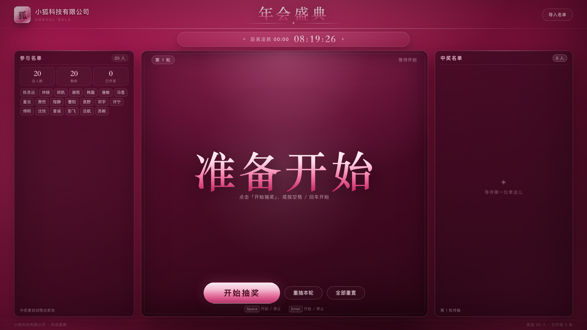

# 年会抽奖程序



一个用于公司年会、团建活动现场的单文件抽奖程序。整个应用只有一个 `index.html`，双击用浏览器打开即可使用，不需要安装依赖、启动服务或连接网络。

## 功能特性

- **开箱即用**：单 HTML 文件，零外部资源，断网也能正常运行。
- **名单管理**：内置 20 人示例名单，支持粘贴导入自定义名单，自动去除空行与重复姓名。
- **滚动抽奖**：点击按钮或按空格 / 回车开始滚动，再次触发即定格并揭晓本轮中奖者。
- **不重复中奖**：中奖者自动移出奖池，后续轮次不会再次抽中。
- **轮次记录**：中奖名单按「第 N 轮 — 姓名」逐条追加，右侧面板实时显示。
- **重抽本轮**：撤销最近一轮结果，该中奖者回到奖池，可重新抽取。
- **全部重置**：二次确认后清空中奖记录、恢复完整奖池。
- **标题可定制**：公司名称与年会标题可直接在页面上点击修改，刷新后保留。
- **凌晨倒计时**：顶栏下方实时显示到下一个凌晨 00:00 的倒计时，跨过零点后自动切到下一轮并给出提示。
- **撒花动画**：揭晓时使用 Canvas 播放彩带礼花，无图片或第三方库。
- **大屏适配**：已针对 1920×1080 与 1366×768 两种常见投屏尺寸做布局校验。

## 快速开始

```bash
git clone https://github.com/claireAllSta/agent.git
cd agent
open index.html          # macOS；Windows 双击 index.html，或使用浏览器打开
```

也可以把 `index.html` 单独拷贝到年会现场的电脑上直接打开。标题设置保存在当前浏览器中，刷新页面不会丢失；中奖记录只保存在内存中，刷新后重新开始。

## 使用说明

### 导入名单

1. 点击右上角「导入名单」。
2. 在文本框中粘贴姓名，支持换行、逗号、顿号、分号、空格分隔，例如：

   ```text
   张三
   李四、王五
   赵六，钱七 孙八
   ```

3. 对话框会实时显示识别到的人数（自动去空行、去重），确认后点击「导入名单」。

> 若当前已有中奖记录，导入新名单会清空记录并从第 1 轮重新开始，页面会给出提示。

### 抽奖操作

| 操作 | 方式 |
| --- | --- |
| 开始 / 停止抽奖 | 点击「开始抽奖」，或按 `空格` / `回车` |
| 重抽本轮 | 点击「重抽本轮」 |
| 全部重置 | 点击「全部重置」，再在弹窗中确认 |
| 关闭弹窗 | 点击「取消」、弹窗遮罩或按 `Esc` |

输入框和可编辑标题内按空格不会误触发抽奖。

### 标题定制

直接点击页面顶部的公司名称或「年会盛典」标题即可编辑，按 `Enter` 或点击空白处确认。修改会保存在浏览器 `localStorage`（键名 `hifox.lottery.titles.v2`）中，刷新页面后仍然生效。

### 倒计时

页面顶栏下方固定显示「距离凌晨 00:00」的倒计时，格式为「时:分:秒」，按本机时间每秒刷新。时间跨过 00:00 时页面会提示「凌晨已到」，并自动开始倒计时到下一个 00:00，无需手动操作；该功能不发起任何网络请求。

## 抽奖规则

- 每轮从当前奖池中随机抽取 1 人，抽中后该姓名移出奖池。
- 轮次从 1 开始连续递增，中奖记录按轮次追加到「中奖名单」。
- 奖池抽空后不再允许抽奖，并提示「奖池已抽完，请重置」。
- 「重抽本轮」只撤销最近一轮；「全部重置」清空全部记录并恢复名单中的所有人。

## 测试

自测脚本使用 Playwright + Chromium 在真实浏览器中运行，覆盖 26 个检查点，包括单文件与零网络请求、名单导入去重、键盘与鼠标操作、撒花动画、不重复中奖、轮次记录、重抽、重置确认、标题持久化、空奖池提示、凌晨倒计时（目标时刻、每秒递减、跨零点自动重算）、两种视口布局以及运行时无 JS 报错。

```bash
python3 -m pip install playwright
python3 -m playwright install chromium
python3 tests/selftest.py
```

运行后会输出逐条 `PASS` / `FAIL` 与汇总结果，并生成：

- `tests/artifacts/selftest-report.json`：结构化测试报告
- `tests/artifacts/screenshot-1920x1080.png`、`screenshot-1366x768.png`：两种视口的页面截图

退出码为 `0` 表示全部通过；当前仓库内的报告为 26/26 通过。

## 项目结构

```text
.
├── index.html                          # 完整的抽奖应用（HTML + CSS + JS）
├── README.md
└── tests
    ├── selftest.py                     # Playwright 自动化自测脚本
    ├── selftest-output.log             # 一次完整自测的终端输出存档
    └── artifacts
        ├── selftest-report.json        # 自测结果
        └── screenshot-*.png            # 布局截图
```

## 技术说明

- 纯原生 HTML / CSS / JavaScript，无构建步骤、无框架、无 CDN 依赖。
- 页面通过 Canvas 绘制撒花动画，通过 `localStorage` 保存标题设置。
- 倒计时按浏览器本机时间计算下一个 00:00，每秒刷新，跨过零点后自动开启下一轮，不使用网络时间或外部资源。
- 为自动化测试提供了接口 `window.__lottery`（`version: "2.1.0"`），包括 `getState()`、`getCountdown()`、`startRoll()`、`stopRoll()`、`redrawRound()`、`reset()`、`importNames()` 等方法。

## 浏览器兼容性

建议使用最新版 Chrome、Edge、Safari 或 Firefox。年会现场投屏推荐使用 Chrome / Edge 的全屏模式；测试脚本以 Chromium 为准。
